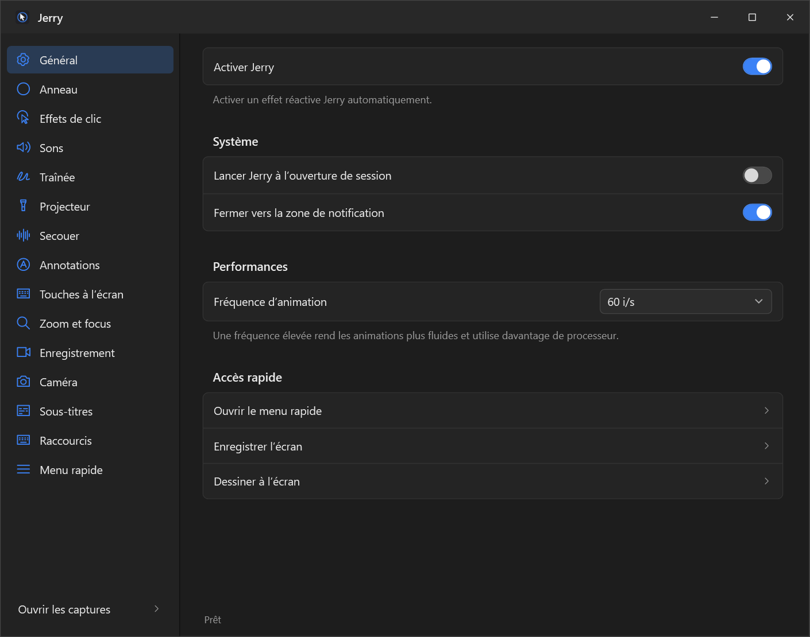
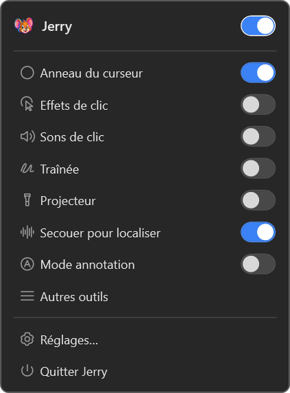

<p align="center">
  
</p>

<h1 align="center">Jerry</h1>

<p align="center"><strong>Votre pointeur, au premier plan.</strong></p>
<p align="center">Outils de présentation, d’annotation et de capture pour Windows.</p>
<p align="center">Windows x64 · .NET 10 · Interface française · Usage personnel</p>

<p align="center">
  <a href="#démarrer">Démarrer</a> ·
  <a href="#au-quotidien">Utilisation</a> ·
  <a href="#développement">Développement</a> ·
  <a href="docs/README.md">Documentation</a>
</p>

---

Jerry accompagne les démonstrations et les enregistrements d’écran : mettez le
pointeur en évidence, dessinez sur le bureau, affichez vos raccourcis et ajoutez
une caméra ou des sous-titres. Les réglages restent accessibles depuis une
interface anthracite compacte et un menu près de l’horloge Windows.

<p align="center">
  
</p>

## Ce que fait Jerry

| Outil | Fonctions |
| --- | --- |
| **Pointeur** | Projecteur à trois formes, anneau animé, sept traînées, sept effets de clic, sons et localisation par secousse. |
| **Annotations** | Crayon, flèche, rectangle, cercle, ligne, surligneur, texte et repères numérotés ; palette, annulation et effacement. |
| **Présentation** | Touches à l’écran, raccourcis globaux, zoom animé, loupe et focus de fenêtre. |
| **Enregistrement** | MP4, 30 ou 60 i/s, résolutions jusqu’à 4K ; pistes système et microphone séparées. |
| **Caméra** | Bulle déplaçable, cercle ou carte, miroir, bordures et aimantation aux coins. |
| **Sous-titres** | Whisper local, transcription en direct ou depuis un fichier, correction par ligne ou mot, six styles et export SRT/MP4. |

## Démarrer

### Installer Jerry

Téléchargez **[Jerry-Setup-0.2.0.exe](https://github.com/nRudzy/Jerry/releases/download/v0.2.0/Jerry-Setup-0.2.0.exe)**
depuis les [versions GitHub](https://github.com/nRudzy/Jerry/releases/latest), puis
ouvrez-le. L'assistant français installe Jerry pour votre compte, sans droits
administrateur, dans `%LOCALAPPDATA%\Programs\Jerry`.

Jerry apparaît dans le **menu Démarrer** et dans **Applications installées** de
Windows. Le raccourci Bureau et le démarrage avec Windows sont facultatifs.
Le runtime .NET et les dépendances natives nécessaires sont inclus.

Les mises à jour conservent vos réglages, captures, modèles et outils téléchargés.
Une capture, un décompte ou un éditeur ouvert bloque le remplacement : terminez
votre travail puis relancez l'installation. Une ancienne copie portable peut
nécessiter **Quitter Jerry** depuis son icône près de l'horloge.

L'installateur et l'application ne sont **pas signés numériquement** : Windows
peut afficher « éditeur inconnu » ou un avertissement SmartScreen. Aucune
modification de politique de sécurité, de PowerShell ou de certificat n'est requise.

### Version portable

L'archive **[Jerry-Windows-x64-0.2.0.zip](https://github.com/nRudzy/Jerry/releases/download/v0.2.0/Jerry-Windows-x64-0.2.0.zip)**
reste disponible. Décompressez **tout son contenu** dans un dossier Windows local,
puis ouvrez `Jerry.exe`. Les DLL, ressources et notices doivent rester avec lui.
`SHA256SUMS.txt` accompagne les deux téléchargements.

### Construire depuis les sources

Prérequis : **Windows x64**, Git et le **SDK .NET 10**. La version de référence du
SDK est indiquée dans [`global.json`](global.json).

```powershell
git clone https://github.com/nRudzy/Jerry.git
cd Jerry
./scripts/build-windows.ps1
.\dist\windows-x64\Jerry.exe
```

Le script lance les tests Core puis construit l’application autonome dans
`dist/windows-x64/`. Les raccourcis `npm test`, `npm run build:windows` et
`npm start` sont aussi disponibles avec Node.js, depuis Windows ou WSL.

Pour produire l'installateur, il faut aussi Inno Setup et les fichiers
redistribuables VC++ x64 officiels de Visual Studio :

```powershell
./scripts/build-installer.ps1 -Version 0.2.0
```

La CI Windows construit et teste les livraisons sur un runner jetable. Ces scripts
de développement n'interviennent pas dans l'installation de la version téléchargée.
Voir le [guide de livraison](docs/windows-delivery.md).

## Au quotidien

- **Choisissez un effet** dans la colonne de gauche ; les réglages s’enregistrent
  automatiquement.
- **Ouvrez le menu rapide** en cliquant sur l’icône Jerry près de l’horloge.
  Les interrupteurs restent utilisables pendant la présentation.
  **Autres outils** déploie les commandes supplémentaires ; la rubrique
  **Menu rapide** personnalise leur visibilité.
- **Dessinez sur l’écran** depuis Général ou le menu rapide. `F`, `A`, `R`, `C`,
  `L`, `H`, `T` et `N` changent d’outil ; `Ctrl+Z` annule, `Suppr` efface,
  `Échap` termine.
- **Préparez une capture** dans Enregistrement : audio, résolution et dossier.
  Placez le pointeur sur le moniteur à enregistrer avant de démarrer.
- **Configurez vos raccourcis** dans Raccourcis. Aucun raccourci global n’est
  imposé au premier lancement.
- **Quittez complètement** avec Quitter Jerry. Fermer les réglages masque la
  fenêtre par défaut ; l’application reste accessible dans la zone de notification.

<p align="center">
  
</p>
<p align="center">
  
</p>

## Vos fichiers

| Données | Emplacement par défaut |
| --- | --- |
| Réglages et sauvegarde | `%LOCALAPPDATA%\Jerry\settings.json` |
| Captures | `Vidéos\Jerry`, modifiable dans Enregistrement |
| Outils vidéo | `%LOCALAPPDATA%\Jerry\tools` |
| Modèles Whisper | `%LOCALAPPDATA%\Jerry\models` |

La capture, l’audio et la transcription sont traités sur cet ordinateur. Le
premier usage télécharge les outils vidéo et le modèle vocal depuis leurs
sources de distribution. Les modèles restent ensuite disponibles hors ligne.
La caméra et les sous-titres en direct sont désactivés au lancement.

**Désinstaller** depuis les paramètres Windows supprime l'application, ses
raccourcis et son démarrage automatique. Vos données personnelles restent à leur
emplacement ; annuler la confirmation de désinstallation ne change rien.

Les intermédiaires récupérables d’une capture restent dans `.Jerry-sessions`,
dans le dossier choisi. Après avoir vérifié le MP4 final, vous pouvez les
supprimer pour libérer de l’espace.

## Développement

```text
assets/branding/         Mascotte néon : source PNG et ICO Windows
src/Jerry.App/           Application WPF, interface et intégration Windows
src/Jerry.Core/          Réglages, entrées, géométrie et logique de sous-titres
src/Jerry.Windows/       Démarrage Windows et communication entre instances
src/Jerry.Maintenance/   Auxiliaire autonome de l'installateur
installer/              Assistant et désinstallateur Inno Setup
tests/Jerry.Core.Tests/  Tests unitaires
tests/Jerry.Windows.UnitTests/ Tests unitaires Windows
tests/Jerry.Windows.Tests/ Vérifications natives et rendus WPF
scripts/                Construction et lancement
docs/                   Guides, périmètre et rapports de vérification
```

Pour exécuter uniquement les tests Core :

```powershell
dotnet test tests/Jerry.Core.Tests/Jerry.Core.Tests.csproj -c Release
```

Les essais d’interface utilisent les vrais composants WPF et un dossier de
réglages temporaire. Leur protocole est décrit dans le
[guide de tests Windows](tests/Jerry.Windows.Tests/README.md).

**État vérifié de la refonte :** 52 tests Core et 2 156 contrôles de composants
Windows réussis. Le dernier contrôle de composition vidéo doit être repris sur
une session déverrouillée. Les scénarios multi-écrans, DPI mixtes et entrées
physiques restent à compléter ; voir le [rapport de validation](docs/windows-verification.md).

L'installation a son [protocole et rapport](docs/windows-installation.md), distincts
des comparaisons fonctionnelles avec MOUZZ. Les tests qui installent et
désinstallent refusent de s'exécuter sur le poste utilisateur.

## Références

Projet personnel publié sur GitHub, inspiré du périmètre étudié de [MOUZZ](https://mouzz.dev/).
La [matrice fonctionnelle](docs/mouzz-scope.md) et les
[observations de référence](docs/mouzz-observations.md) distinguent les éléments
observés, les choix de Jerry et les points inconnus. L’original n’a pas été
exécuté sur macOS pendant ce travail ; la parité exhaustive n’est pas certifiée.

La [mascotte néon](assets/branding/README.md), inspirée de Jerry de Tom et Jerry,
est fournie en PNG et ICO et intégrée à l’exécutable. Son dessin remplit la zone
de notification, avec une image choisie à la taille native de Windows. Montserrat et Oswald sont livrées avec leurs licences
[OFL](src/Jerry.App/Assets/Fonts/) et leur provenance. Les dépendances principales
sont WPF/.NET, NAudio et Whisper.net ; FFmpeg est acquis séparément.

REA est l’outil de travail utilisé pour l’analyse. Son installation dans le
checkout voisin est décrite dans le [guide REA](docs/rea-setup.md).
Les applications originales, les preuves brutes, les réglages de machine et les
sorties de compilation restent exclus de Git.
