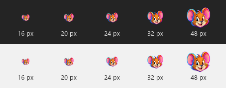

# Mascotte Jerry — néon

Une tête de souris expressive aux grandes oreilles, inspirée de Jerry dans
**Tom et Jerry**. La fourrure dorée et le museau crème gardent le caractère du
personnage ; les contours cyan, magenta et violets donnent le traitement néon.
La silhouette utilise toute la largeur disponible, sur fond transparent.

| Fichier | Usage |
| --- | --- |
| [jerry-source.png](jerry-source.png) | Illustration source haute définition générée avec ImageGen. |
| [jerry.png](jerry.png) | Export transparent 1 024 × 1 024 pour le README et les présentations. |
| [jerry.ico](jerry.ico) | Icône Windows : 16, 20, 24, 32, 40, 48, 64, 96, 128 et 256 pixels. |
| [prompt.txt](prompt.txt) | Prompt utilisé pour la création de la mascotte. |
| [provenance.json](provenance.json) | Méthode, empreintes et traitement des exports. |

## Lisibilité dans la zone de notification

Les marges entièrement transparentes de la source sont retirées avant les
exports. Les proportions sont conservées et chaque taille est calculée
séparément à partir de la source haute définition, sans cadre sombre autour du
personnage.

L’application charge une image distincte à la taille des petites icônes donnée
par Windows, via `SystemInformation.SmallIconSize`. La fenêtre conserve son
image de 32 pixels. Sur l’écran testé à 150 %, l’icône de notification est
chargée en **24 × 24**, avec un premier plan visible de **24 × 20 pixels**.



Référence : [tailles des icônes Windows](https://learn.microsoft.com/en-us/windows/win32/menurc/about-icons).

## Réexporter

Les fichiers sont intégrés au projet WPF ; le dessin source peut être réexporté
avec Python 3 et Pillow, depuis la racine du dépôt :

```text
python -m pip install Pillow
python scripts/export-icons.py
```

Ces outils servent à préparer les ressources graphiques. La version Windows
portable conserve son fonctionnement autonome.

L’ancien logo au pointeur reste consultable dans l’historique Git. Le nouveau
visuel est un hommage personnel à Jerry de Tom et Jerry.
